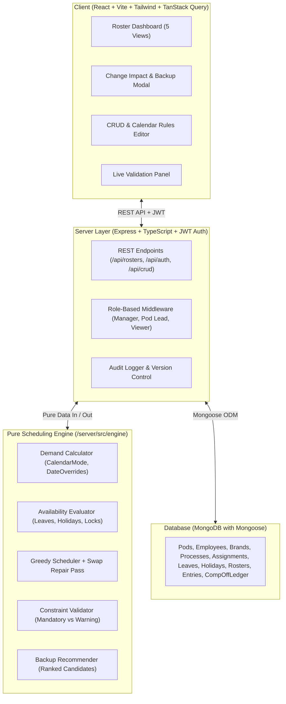

# Smart Roster Management System

> Production-grade, deterministic, and conflict-aware roster scheduling engine and multi-brand operations management platform for D2C operations companies.

---

## 📌 Submission Approach Note (For Email)
> "We architected the Smart Roster System around a strict separation of concerns: the **Process Operating Calendar** (when client brands legally mandate coverage) is completely decoupled from the **Employee Working Schedule** (when human staff actually work). The core scheduling engine is implemented as pure, side-effect-free TypeScript functions with a greedy-with-repair algorithm that prioritizes most-constrained resources, enforces hard labor and coverage limits, rotates weekend offs fairly, and prevents silent coverage deficits through immediate human-readable validation deltas and automated backup recommendations."

---

## 🏛️ System Architecture



### Key Architectural Tenet: Process Operating Calendar vs. Employee Working Schedule
- **Process Operating Calendar**: Defines *demand* (`ALL_365`, `EXCEPT_HOLIDAYS`, `EXCEPT_SUN_AND_HOLIDAYS`, `CUSTOM`, weekday minimums, and date-specific overrides). It does **not** know who works; it only knows how many staff are required each day.
- **Employee Working Schedule**: Defines *supply* (shift status `WORK`, `WEEKLY_OFF`, `HOLIDAY`, `LEAVE`, `COMP_OFF`).
- **Scheduling & Validation Engine**: Sits in between as a pure mathematical function. A roster that is silently invalid is considered a total failure; hard constraints always trump soft preferences.

---

## 🛠️ Tech Stack & Monorepo Structure

- **Backend**: Node.js, Express, TypeScript, MongoDB with Mongoose, Zod.
- **Frontend**: React 18, TypeScript, Vite, Tailwind CSS, React Router v7, TanStack Query v5, Lucide React.
- **Testing**: Vitest for the pure scheduling engine.
- **Auth**: JWT-based authentication with 3 roles: `manager` (full control + override authority), `pod_lead` (pod-level operations & roster editing), `viewer` (read-only agent view).
- **Deployment**: Backend ready for Render, Frontend ready for Vercel, Database on MongoDB Atlas (with automatic zero-dependency in-memory fallback for local dev).

```
.
├── package.json               # Root monorepo configuration
├── .env.example               # Environment variables template
├── render.yaml                # Render deployment configuration
├── server/
│   ├── src/
│   │   ├── config/            # DB connection (Atlas / Local / MongoMemoryServer fallback)
│   │   ├── types/             # Shared domain types
│   │   ├── models/            # Mongoose schemas (Indexed: rosterId, employeeId, date)
│   │   ├── engine/            # PURE FUNCTIONS ONLY (Zero DB/Express imports)
│   │   │   ├── dateUtils.ts   # Weekday and date utilities
│   │   │   ├── demand.ts      # Process operating calendar demand computation
│   │   │   ├── availability.ts# Employee availability mapping
│   │   │   ├── validator.ts   # Comprehensive validation & human-readable conflict generator
│   │   │   ├── scheduler.ts   # Greedy weekly-off assignment + constraint repair pass
│   │   │   ├── impact.ts      # Change impact analysis across all brands
│   │   │   ├── recommender.ts # Ranked backup candidates & trade-off summaries
│   │   │   └── index.ts
│   │   ├── controllers/       # Roster, Auth, and CRUD controllers
│   │   ├── routes/            # REST API routes
│   │   ├── middleware/        # JWT auth, role authorization, errorHandler
│   │   ├── scripts/seed.ts    # Seed script (36 employees, 6 pods, 25 brands)
│   │   ├── tests/engine.test.ts # Vitest suite for pure engine
│   │   └── server.ts          # Express application entrypoint
│   └── package.json
└── client/
    ├── src/
    │   ├── api/               # API client with token management
    │   ├── context/           # AuthContext with 1-click persona switcher
    │   ├── components/
    │   │   ├── layout/        # Navbar, Sidebar, Layout
    │   │   └── roster/        # CompanyView, PodView, BrandView, ProcessView,
    │   │                      # EmployeeView, IssuesPanel, CellEditModal, ImpactModal, PublishModal
    │   ├── pages/             # RosterPage, LoginPage, and Setup CRUD pages
    │   └── types/             # Frontend interfaces
    ├── vercel.json            # Vercel SPA rewrites
    └── package.json
```

---

## ⚡ Quick Start (Local Setup)

### Prerequisites
- Node.js >= 18.x (tested on v22.14.0)
- npm >= 9.x

### 1. Clone & Install Dependencies
```bash
git clone <repo-url>
cd "Smart Roster Management System"
npm install
```

### 2. Configure Environment Variables
Copy `.env.example` to `.env` in the root (or server):
```bash
cp .env.example .env
```
Default values:
```env
MONGODB_URI=mongodb://127.0.0.1:27017/smart_roster
JWT_SECRET=super_secret_jwt_key_ops_roster_2026_d2c
PORT=5000
CLIENT_URL=http://localhost:5173
NODE_ENV=development
```
*(Note: If no local MongoDB is running, the server automatically starts a zero-configuration embedded in-memory MongoDB instance!)*

### 3. Run the Unit Test Suite (Vitest)
Verify that all pure engine algorithms, demand calculations, and repair passes pass:
```bash
npm run test
```
*(11 of 11 tests pass in ~50ms!)*

### 4. Seed the Database
Populate 36 employees, 6 pods, 25 brands, operating processes, India public holidays, and the built-in demo conflict scenario:
```bash
npm run seed
```

### 5. Start the Development Servers
```bash
npm run dev
```
- Frontend UI: `http://localhost:5173`
- Backend API: `http://localhost:5000`
- API Health Check: `http://localhost:5000/health`

---

## 👥 Demo Login Credentials (1-Click Switcher Available on UI)

The web UI includes a **1-Click Demo Persona Switcher** in the navigation header:

| Role | Name | Email | Password | Permissions |
| :--- | :--- | :--- | :--- | :--- |
| **Manager** | Aditya Manager | `manager@ops.com` | `password123` | Full access, override mandatory publish blocks, manage rules |
| **Pod Lead** | Vikram Malhotra | `lead.pod1@ops.com` | `password123` | Pod 1 leadership, shift edits, assignment matrix |
| **Viewer** | Riya Sharma | `riya.sharma@ops.com` | `password123` | Demo sole resource agent (Zing Support) |

---

## 🎯 Built-in Demo Scenario (Live Conflict & Impact Resolution)

1. **The Scenario**: Brand **Zing Support** has a single assigned resource (**Riya Sharma**) handling both its 365-day Customer Support and NDR Escalations processes.
2. **The Conflict**: Riya Sharma has an approved leave scheduled on **Sunday, July 12, 2026**.
3. **The Result**: Because Zing Support runs 365 days a year with a minimum staffing requirement of 1, her absence causes an immediate zero-staff outage (`SOLE_RESOURCE_UNAVAILABLE` & `ZERO_STAFF`).
4. **How to Demo in 3 Clicks**:
   - Navigate to the **Roster Dashboard**.
   - Observe the red conflict badge on Sun Jul 12 and the **Mandatory Issues** card.
   - Click **"Impact & Backup Recommender"** (or click the conflict in the Issues panel).
   - The system performs a multi-brand impact analysis across Zing CS and NDR, identifies eligible cross-trained or same-pod backups (e.g. Aman Verma or Pod 1 peers), ranks them by score, and presents actionable trade-offs:
     - *"Swap Aman Verma's weekly off from Sun Jul 12 to Wed Jul 15; this resolves the gap with zero new deficits."*
   - Click **"Apply Suggestion"**: The system executes the swap, marks the entries, updates the live validation delta, records comp-off accruals if applicable, and leaves the roster 100% compliant!

---

## 📊 The 5 Roster Views

1. **Company View (Grid)**: Complete Employee × Day matrix (31 days). Color-coded cells (`W`, `OFF`, `HOL`, `LV`, `CO`), locked shift indicators, and pulse markers for active conflicts. Click any cell to manually modify and trigger live validation deltas.
2. **Pod View**: Grouped team view showing Pod Leads, active pod members, shift distributions, and pod-specific health metrics.
3. **Brand View (Coverage Heatmap)**: All 25 D2C brands × 31 days showing daily `Actual / Required` staffing. Color-coded:
   - 🟢 **Green**: 100% staffed.
   - 🟡 **Amber**: Understaffed (below minimum).
   - 🔴 **Red**: Zero staff outage on an open day.
   - ⚪ **Grey**: Brand process closed.
4. **Process View**: Process operating calendar demand breakdown across brands, showing calendar modes (`ALL_365`, `EXCEPT_HOLIDAYS`, etc.) and date overrides.
5. **Employee View**: Individual monthly calendar grid showing daily assignments, fatigue risk, and shift totals (Work, Offs, Leaves, Holidays worked, Comp-offs earned).

---

## 🧠 "Tell Us How You Think" — 8 Engineering Answers

### 1. Data Modelling & Calendar Separation
**Decision**: We explicitly decoupled the **Process Operating Calendar** from the **Employee Working Schedule**.
- A `Process` defines when coverage is required, its operating mode (`ALL_365`, `EXCEPT_HOLIDAYS`, `EXCEPT_SUN_AND_HOLIDAYS`, `CUSTOM`), default staffing, weekday variations, and date overrides.
- An `Employee` defines human labor constraints: maximum consecutive work days (default 6), target weekly offs per week (default 1), preferred off days, and avoid days.
- An `Assignment` links them in an $M:N$ relationship with an allocation percentage.
- **Why this matters**: In multi-brand D2C ops, client operational requirements do not depend on who is hired; similarly, labor laws and employee contracts do not depend on client SLA hours. Coupling them directly in the database leads to schema rigidity, impossible queries, and brittle validation.

### 2. How Roster Generation and Constraint Checking Work
- **Step 1 (Demand Matrix)**: For every process and date $D$, evaluate operating status and minimum staff required from calendar mode, holiday lists, and date overrides.
- **Step 2 (Availability Matrix)**: For every employee and date $D$, evaluate fixed states: existing manual/locked entries, approved leaves, and public holidays (granted *only if all* of an employee's assigned processes are closed that day).
- **Step 3 (Greedy Assignment Ordered by Constraint)**: Employees are ordered **most-constrained first**. A sole resource for an active process has the highest constraint weight, followed by employees in smaller staffing pools. For each week, candidate off days are scored: $+1000$ for zero process deficit, $+200$ for respecting consecutive work limits, $+80$ for preferred off days, $-100$ for avoid days, and a fairness bonus for rotating weekend offs.
- **Step 4 (Repair Pass)**: If an employee's candidate off days all cause deficits, the engine initiates a local search swap: it inspects peers in the same process/pod who currently have off days, checks if swapping days with them resolves the gap without creating a new deficit, and applies the swap. If still unresolvable, the day is assigned and flagged as a mandatory issue.
- **Step 5 (Validation Pass)**: Evaluates all entries against hard rules (zero staff, below min, sole resource off, $>6$ consecutive days, leave conflicts, $<1$ weekly off, process overload) and soft warnings (preference violations, edge of capacity).

### 3. Single vs. Multi-Resource Brands
- **Single-Resource Brands (80% of brands)**: The assigned employee has zero redundancy. The scheduler treats them with maximum constraint priority. If the brand operates 365 days, the employee can **never** take a weekly off on a working day without another agent cross-covering. The engine forces off days onto days when the process is closed (or flags the deficit for manager backup assignment).
- **Multi-Resource Brands (20% of brands)**: Staffing pools (2-3 agents) allow staggered offs. The engine rotates weekend offs across the team so Agent A gets Sunday in Week 1, Agent B gets Sunday in Week 2, etc., preventing fatigue and resentment.

### 4. Handling Sole Employee Unavailability
When a sole employee takes an approved leave or emergency sick leave:
1. The **Demand Matrix** still demands coverage.
2. The **Availability Matrix** marks the sole employee as `LEAVE`.
3. The engine marks the process as `0 of 1 staff` and immediately raises a `SOLE_RESOURCE_UNAVAILABLE` issue with `MANDATORY` severity.
4. The **Change Impact & Backup Recommender** analyzes candidate employees:
   - Filters out anyone on leave or already at maximum consecutive work days.
   - Evaluates employees in the **same pod** first, then other pods.
   - Checks if a candidate currently on `WEEKLY_OFF` can swap their off day to another date in the same week where their own processes have surplus staff.
   - Computes a transparent trade-off score and presents a 1-click resolution.

### 5. Conflicting Requirements & Insufficient Staffing
- **Core Philosophy**: *A roster that is silently invalid is a failure.* The system never hides a deficit.
- **Priority Hierarchy**:
  $$\text{Hard Constraints (Coverage \& Labor Laws)} > \text{Manager Overrides} > \text{Soft Preferences (Preferred Offs)}$$
- If staffing is mathematically insufficient to cover demand:
  1. The engine generates the best possible schedule to minimize total deficit hours.
  2. Every unfilled shift is flagged with a human-readable `MANDATORY` issue.
  3. **Publishing is strictly blocked**.
  4. The system allows an **Operations Manager** to override the block *only* by entering an explicit business justification (e.g., client agreed to reduced coverage), which is committed to the immutable Audit Log.

### 6. Automated vs. Human-Controlled
- **Automated**:
  - Baseline monthly schedule generation.
  - Multi-brand coverage calculations and holiday comp-off ledger accruals.
  - Conflict detection across all labor and contract constraints.
  - Local repair swaps and ranked candidate backup recommendations.
- **Human-Controlled**:
  - Approving leave requests.
  - Authorizing cross-brand reassignments.
  - Locking individual shifts (manual overrides that the engine must respect).
  - Authorizing mandatory publishing overrides with documented reasons.

### 7. Scaling to 2x (72 Employees, 50 Brands)
- **Engine Performance**: The current pure scheduling engine processes 36 employees across 31 days in **~50 milliseconds** (algorithmic complexity is $\mathcal{O}(W \times E \times P)$, where $W \le 5$ weeks, $E$ employees, $P$ processes). At 72 employees and 50 brands, execution will take $\sim 150\text{ ms}$, remaining entirely interactive.
- **Database Scaling**: Compound indexes on `(rosterId, employeeId, date)` and `(rosterId, date)` ensure constant-time cell lookups.
- **Organizational Partitioning**: The Pod architecture naturally shards scheduling: Pods operate as independent failure domains, allowing parallel scheduling across pods.

### 8. What I'd Improve with One More Week
1. **Integer Linear Programming (ILP) Solver**: Complement the greedy-with-repair algorithm with a WebAssembly-compiled constraint solver (e.g. Google OR-Tools or MiniZinc) for provably optimal multi-objective Pareto frontiers.
2. **Shift Swapping Marketplace**: A self-service portal where agents can propose shift swaps with peers in their pod, automatically simulating validation before routing to the pod lead for approval.
3. **Real-time WebSockets / SSE**: Push notifications to connected managers and pod leads when an unscheduled sick leave is logged, instantly highlighting affected brand cells.
4. **Historical Fairness Balancing**: Persisting weekend off counts across calendar quarters to ensure long-term fairness in weekend distribution.

---

## 🚀 Deployment Guide

### Deploy Backend on Render
1. Push repo to GitHub.
2. Create a new **Web Service** on [Render](https://render.com).
3. Connect repository. Render will automatically detect `render.yaml`.
4. Environment variables to supply:
   - `MONGODB_URI`: Your MongoDB Atlas connection string.
   - `JWT_SECRET`: Random 32+ character secret string.
   - `CLIENT_URL`: URL of your deployed Vercel frontend.
5. Build Command: `npm install && npm run build --workspace=server`
6. Start Command: `npm run start --workspace=server`

### Deploy Frontend on Vercel
1. Create a new project on [Vercel](https://vercel.com).
2. Set Root Directory to `client`.
3. Framework Preset: **Vite**.
4. Set rewrite destination in `client/vercel.json` to point `/api/(.*)` to your Render backend URL.
5. Deploy!

---

## 🧪 Running Engine Tests
```bash
cd server
npm test
```
```
 RUN  v3.2.7 server
 ✓ src/tests/engine.test.ts (11 tests) 48ms
 Test Files  1 passed (1)
      Tests  11 passed (11)
```

---

## 📄 License
MIT © 2026 Operations Systems Engineering.
# Smart-Roster-Management-System

